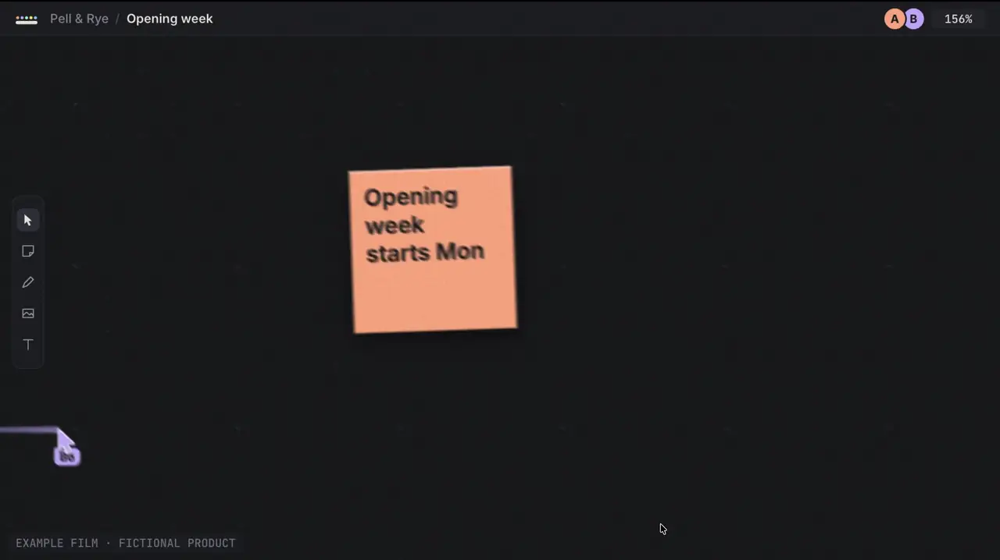
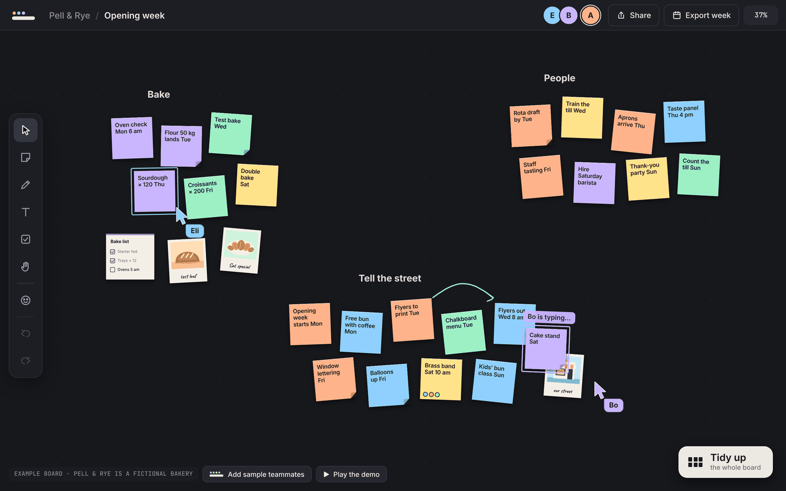
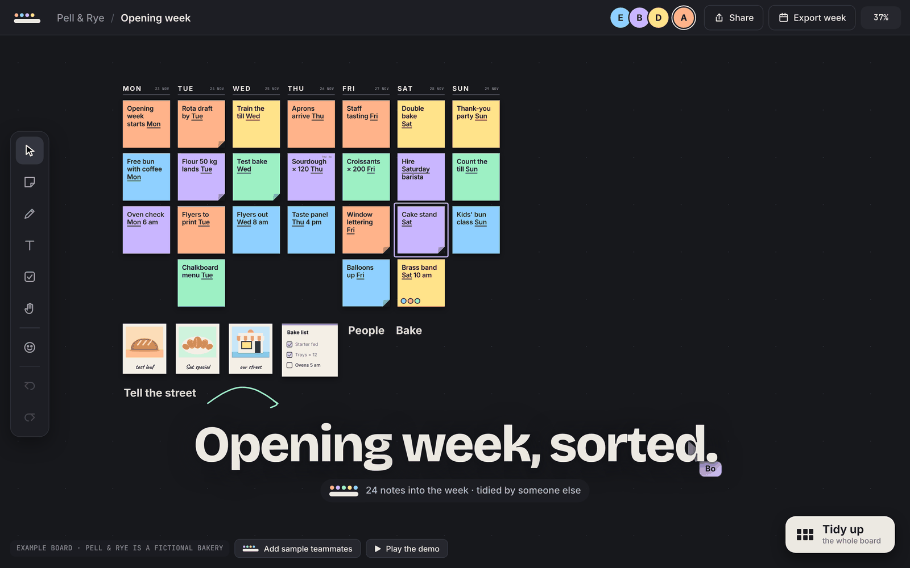
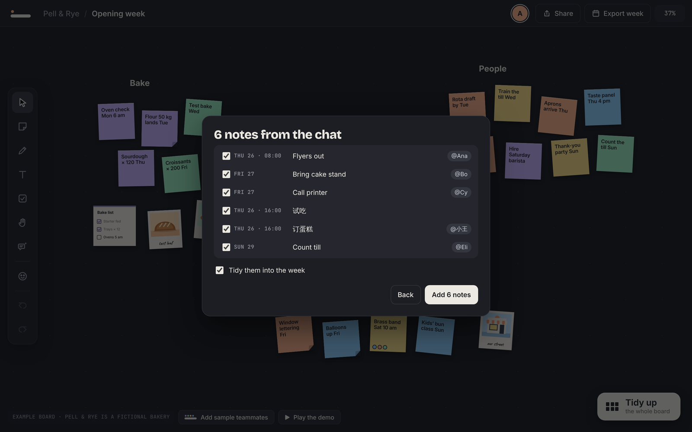
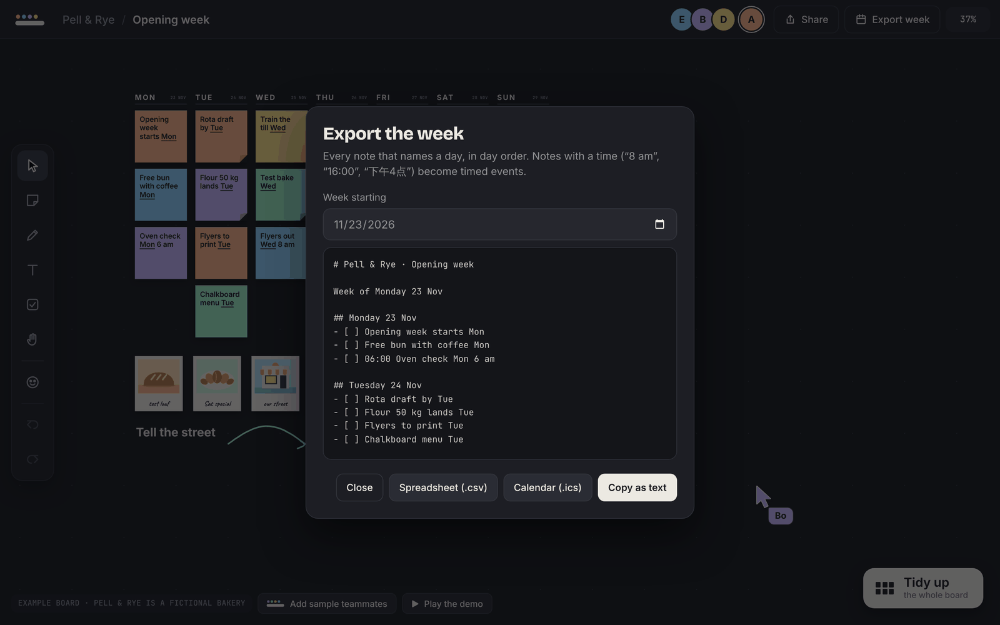
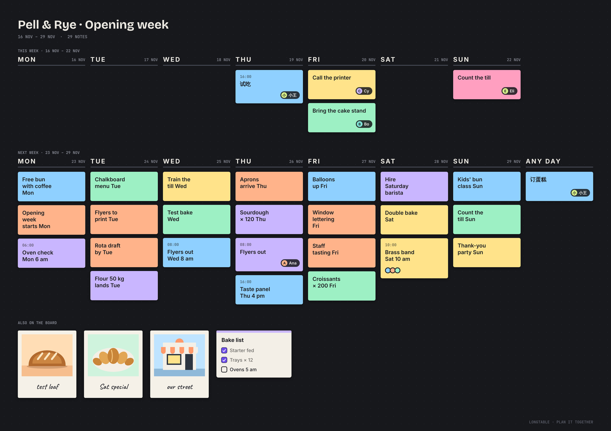
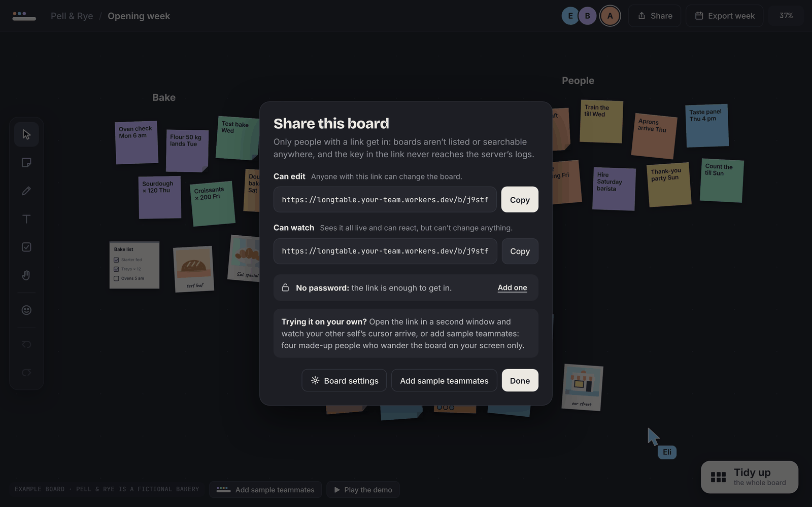
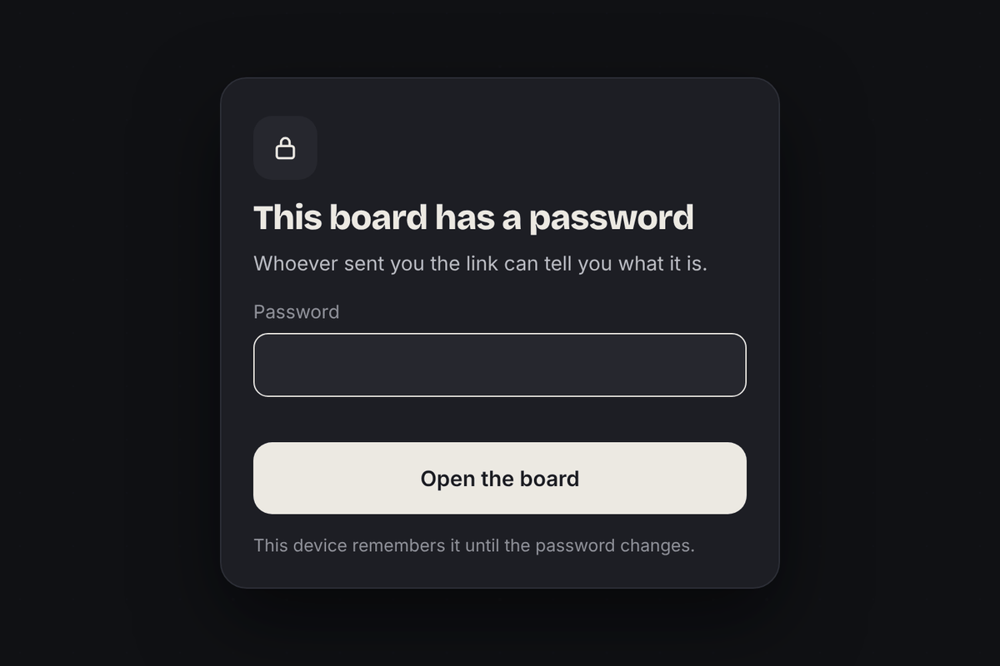
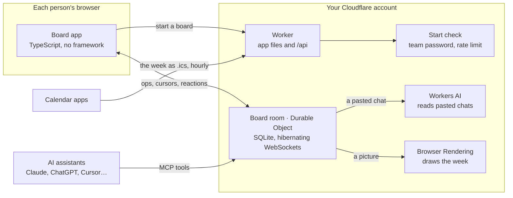

<div align="center">


# Longtable

**Plan it together. Then one click sorts the mess into a week.**

A live, shared planning board: everyone writes sticky notes at once and sees each
other's cursors and typing. Paste the group chat and it becomes notes. **Tidy up**
files every note into the day it names, and the week shows up in everyone's
calendar. Your AI assistant can plan on it too, over MCP.

**English** · [简体中文](README.zh-CN.md)

[](https://deploy.workers.cloudflare.com/?url=https://github.com/s045pd/longtable)
&nbsp;
[](LICENSE)
[](DEPLOY.md#what-the-free-plan-covers)
[](#private-by-default)



<sub>The film Longtable grew out of: five made-up people plan a fictional bakery’s opening week, then Ana presses Tidy up. The front page plays the same story live.</sub>

</div>

---

## Contents

- [What it does](#what-it-does)
- [Private by default](#private-by-default)
- [Run your own](#run-your-own)
- [Keyboard](#keyboard)
- [Develop](#develop)
- [How it is built](#how-it-is-built)
- [License and credits](#license-and-credits)

## What it does

<table>
<tr>
<td width="50%" valign="top">

### Plan live, with anyone who has the link

No sign-up: a board is a link. Cursors carry a name flag, selections show in
each person's colour, and words appear on everyone's screen as they are typed.
Click a face in the top bar and your view follows theirs.

Double-click for a **note**, or pick a **heading**, **checklist** or **pen**.
Drag to move, `Alt`-drag to copy, paste a short list to get one note per line.
Vote with dots in your colour and send reactions that float up from your
cursor.

Click the logo for **Your boards**: every board opened on this device, one
click away, with no link to find again.

</td>
<td width="50%"></td>
</tr>
<tr>
<td width="50%"></td>
<td width="50%" valign="top">

### Tidy up into a week

Write the day on a note, the way people do: “Flyers out Wed 8 am”,
“Brass band Sat 10 am”, “周四下午4点试吃”. **Tidy up** springs every note
into its day's column in a wave, untimed notes first, then by time. Notes
with no day get an *Any day* column; photos, lists and headings line up
under the week. Tidy again later and new notes slot into the week you have.
One undo takes it all back.

A note can also carry a date of its own. Today's jobs stay in this week, and
next week's get a week of their own underneath, so one board holds “today”
and “next Wednesday” at once without pushing anything a week out.

Prefer to choose? Press **Day** (`D`) to pick a date, a time and whose it is,
or drag a note into a column. Whose it is shows as a name tag in the note's
corner, not as “@name” in its words.

</td>
</tr>
<tr>
<td width="50%"></td>
<td width="50%" valign="top">

### Paste the group chat, get a plan

Paste a chat, meeting notes or a to-do list (or press the chat button) and
[Workers AI](https://developers.cloudflare.com/workers-ai/) picks out what
needs doing: one note per task, with the date, the time and who took it on.
“Today”, “tomorrow” and “next Wednesday” are worked out from today's date,
and it reads the whole chat first, so “actually Friday instead” moves the
task rather than adding another. A note stays in the language it was
written in. Look the notes over, untick any you don't want, and add them tidied into
the week.

It runs on your own Cloudflare account's free AI allowance. The chat is
never stored or logged, only the notes you add. Without AI (running locally,
or once the day's allowance is used up) each line becomes a note instead.

</td>
</tr>
<tr>
<td width="50%" valign="top">

### Keep it in your calendar

**Export week → Keep it in your calendar** subscribes Google Calendar, Apple
Calendar or Outlook to the board. Every note that names a day is an event,
timed or all day, and when the plan changes, the calendars follow on their
own. No sign-in, nothing to install.

Switch to **Just mine** and the calendar, the text and the files keep only
the notes tagged with your name (or that say “@you”), so everyone can
subscribe to their own jobs. The same dialog copies the week as Markdown for
a chat, or downloads a **CSV** for a spreadsheet or a one-off **`.ics`** file.

</td>
<td width="50%"></td>
</tr>
<tr>
<td width="50%"></td>
<td width="50%" valign="top">

### Send the week as a picture

**Picture** draws the whole week, every card with its time and name tag,
the photos and the checklists, as one sharp PNG to drop into a group chat.
On a phone it opens the share sheet. **Just mine** works here too.

### Works on a phone, and offline for a while

One finger pans, two pinch, the tools sit at the bottom. Changes made while
the connection drops are kept and sent when it comes back.

</td>
</tr>
</table>

## Plan with your AI assistant

Every board is also an [MCP](https://modelcontextprotocol.io) server. Copy
its address from **Share → Plan with an AI assistant** and add it to your
assistant:

- **Claude:** Settings → Connectors → Add custom connector, and paste it.
- **Claude Code:** `claude mcp add --transport http longtable <address>`
- **ChatGPT, Cursor and others:** add an MCP server by URL (Streamable HTTP).

Then ask in your own words: “put tomorrow's deliveries on the board for Bo”,
“what's on for me this week?”, “move the tasting to Friday at 3”, “send me
the week as a picture”. Whatever the assistant changes, everyone on the board
sees happen live, and the notes fly into their days like a tidy.

| Tool | What it does |
| --- | --- |
| `read_board` | Every note with its id, date, time and who it's for, in date order; checklists and headings. Just one person's, if asked. |
| `week_as_text` | The week as a Markdown checklist. |
| `week_picture` | The week as a PNG, drawn like **Export → Picture**, for the assistant to show you. |
| `add_notes` | Up to 40 notes at once, with real dates, times and names, tidied into their days. |
| `update_note` | Change a note's words, date, time or person; it moves column with its day. |
| `delete_notes` | Remove notes; the weeks close up. |
| `tidy_up` | Tidy the whole board. |
| `calendar_link` | Google, Apple and Outlook subscription links, for everyone or one person. |

The address works like the edit link: anyone with it can change the board,
so only people who can edit see it, and new links or a new password switch
it off. Pictures come from Cloudflare Browser Rendering (on the free plan,
roughly a hundred a day); without it, the assistant gets the week as text.

## Private by default

<table>
<tr>
<td width="50%"></td>
<td width="50%"></td>
</tr>
</table>

A board's address opens nothing on its own. Its links carry a secret key after
the `#`, and browsers never send that part to a server, so it stays out of
logs. **Share** gives two links: one that can **edit**, and one that can
**watch** (see everything live, point and react, but change nothing).

Whoever starts a board owns it. Under **Settings** in the top bar the owner can:

- **add, change or remove a password.** Everyone else needs it once per
  device, and changing it sends people who are on the board right then back
  to the password screen.
- **make new links.** The old ones stop working at once.
- **clear the board** (Undo brings it back) or **delete it** from the server
  for good. You go straight on to the board you had open before it.

**Your boards → Manage boards** deletes several boards you own at once, or
takes boards off this device's list without touching them.

| | How |
| --- | --- |
| Link keys | 26 random characters (about 130 bits). The owner key is stored only as a SHA-256 hash. |
| Passwords | PBKDF2-SHA-256 with 100,000 rounds and a salt for each board. After five wrong tries from one address the board waits 30 seconds, doubling up to 15 minutes. The count is kept in the board's storage for a day, under a hash of the address. |
| Watch links | The server refuses every change sent with one, not just the page. |
| Calendar links | A key of their own that can only read the notes that name a day. New links or a new password switch the old one off. |
| AI assistants (MCP) | A key of their own in the board's MCP address, shown only to people who can edit. It can change the board like the edit link; new links or a new password switch it off. One address can make 600 requests an hour to a board. |
| Pasted chats | Read by Workers AI on your own account and then dropped: never stored, never logged. A watch link can't send one. |
| Starting boards | Optional **team password**. Without one, an address can still start only 30 boards an hour. |
| The pages | Strict Content-Security-Policy, no referrer, no framing, and every page asks not to be indexed. |
| Deleting | Erases the board's storage. Only the date it was deleted is kept, so its link can say so. |

To put the whole site behind your company sign-in, add
[Cloudflare Access](https://developers.cloudflare.com/cloudflare-one/applications/configure-apps/self-hosted-public-app/)
in front of it. It's free for up to 50 people.

Found a security problem? See [SECURITY.md](SECURITY.md).

## Run your own

Longtable runs entirely on **Cloudflare's free plan**. One Worker serves the
app and its API, and each board is a
[Durable Object](https://developers.cloudflare.com/durable-objects/) with its
own SQLite database. Your boards stay in your Cloudflare account, and no other
service is involved.

**With one API token** (you need Node.js 20 or newer):

1. Make a token with this link, which fills in the two permissions it needs:
   **[Create the Longtable token](https://dash.cloudflare.com/profile/api-tokens?permissionGroupKeys=%5B%7B%22key%22%3A%22workers_scripts%22%2C%22type%22%3A%22edit%22%7D%2C%7B%22key%22%3A%22account_settings%22%2C%22type%22%3A%22read%22%7D%5D&accountId=*&zoneId=all&name=Longtable%20deploy)**.
2. In this folder, run:

   ```sh
   npm run setup
   ```

   Paste the token when asked (it isn't shown or saved). Setup finds your
   account, asks for a name and an optional team password, then builds,
   deploys and checks the result. It ends with your address:
   `https://longtable.<your-subdomain>.workers.dev`.

To update later, get the new code and run `npm run setup` again. Boards are kept.

**Other ways:** the **Deploy to Cloudflare** button above (it copies the
repository into your GitHub account, so it needs this repository to be
public), a GitHub Actions workflow that deploys from your own copy, or
`npx wrangler login` and `npm run deploy` by hand. [DEPLOY.md](DEPLOY.md)
covers each one, plus your own domain, what the free plan covers and where
the data is kept.

## Keyboard

| Key | Does | Key | Does |
| --- | --- | --- | --- |
| `V` | Select | `U` | Tidy up |
| `N` | Note | `D` | Pick the day, time and who |
| `T` | Heading | `Enter` | Edit the selected note |
| `C` | Checklist | `Delete` | Delete |
| `P` | Pen | Arrows | Nudge (`Shift` for more) |
| `H` or hold `Space` | Pan | `⌘D` | Duplicate |
| `+` `−` | Zoom | `⌘A` | Select everything |
| `⇧1` / `⇧0` | Fit all / 100% | `⌘Z` / `⇧⌘Z` | Undo / redo |

`Esc` stops the demo and hands its board to you. On Windows and Linux use `Ctrl` for `⌘`.

## Develop

```sh
npm install
npm run dev:worker     # builds, then serves the app with live boards at http://localhost:8787
npm run dev:worker:ai  # the same, with real Workers AI for pasted chats (npx wrangler login first)
npm run dev            # the front end alone, with hot reload; boards stay in this browser
```

`dev:worker` runs without Cloudflare, so a pasted chat becomes one note per
line there; `dev:worker:ai` sends the AI part to your Cloudflare account.

```sh
npm test               # unit tests: reading days and times, the tidy, checks, exports, access
npm run typecheck      # the app and the Worker
npm run build && npm run e2e
```

The end-to-end run starts a local Worker and drives several browsers and a
phone with Playwright (`npx playwright install chromium` once if needed). It
covers live editing between people, the tidy, the export, and the privacy
rules: keyless and made-up links, the watch link (also against a script
talking to the server directly), passwords and the wait after wrong ones,
guesses sent all at once, new links, clear, delete, the team password, the
limit on new boards and the security headers. It also pastes a chat, checks
the calendar feed and its key, that notes dated next week get a week of
their own, name tags, *Just mine* and the picture, and an MCP client planning
on a board. Against a deployed Longtable the chat goes to
real Workers AI. To test a deployed Longtable:
`BASE_URL=https://… npm run e2e` (add `TEAM_PASSWORD=…` if it has one).

## How it is built



Every change is an **op**: `put`, `patch`, `del`, `vote` or `meta`. A browser
applies its own ops at once, keeps their inverse for undo and sends them. The
board's room checks each op against the schema, applies it in arrival order,
passes it to everyone else, and writes what changed to storage at most once a
second, so a drag is one write rather than hundreds. Text, positions and
colours are last-writer-wins per field; votes belong to each person, so two
votes never collide. Cursors, selections and who is online are relayed but
never stored. Idle tabs keep their socket without waking the room, so an open
but quiet board costs nothing.

```
src/shared/   the model both sides share: items and ops, the checks every change passes,
              applying and undoing, reading days and times, the tidy, exports and the
              calendar feed, reading a chat (plan.ts), templates
src/board/    the board in the browser: state and undo (app.ts), items (views.ts), pointer,
              touch and keys (input.ts), typing (editor.ts), cursors (people.ts), bars and
              dialogs (chrome.ts), the connection (net.ts), the front page's demo (demo.ts),
              the week as a picture (picture.ts)
worker/       the API and static files (index.ts), one board's room with its calendar
              feed and chat reading (room.ts), keys, passwords and wrong tries (access.ts),
              the MCP server (mcp.ts) and its pictures (picture.ts, with picture.html)
scripts/      npm run setup (deploy-cloudflare.mjs)
e2e/          the end-to-end run
```

The look comes from the film Longtable grew out of: a dark canvas with a dot
grid that coarsens as you zoom out, notes in five sherbet colours with dark
ink, Inter for the interface, Bricolage Grotesque for the closing line and
Caveat for handwritten captions.

## License and credits

Copyright © 2026 s045pd. Longtable is free software under the
[GNU Affero General Public License v3.0](LICENSE): use it, change it and run
it for your team as you like. If you run a changed version for other people
over a network, offer them the source of your changes too.

The fonts are bundled from [Fontsource](https://fontsource.org) under the SIL
Open Font License: Inter, Bricolage Grotesque, Caveat and JetBrains Mono.
Pell & Rye, the people on its board and everything they plan are fictional.
