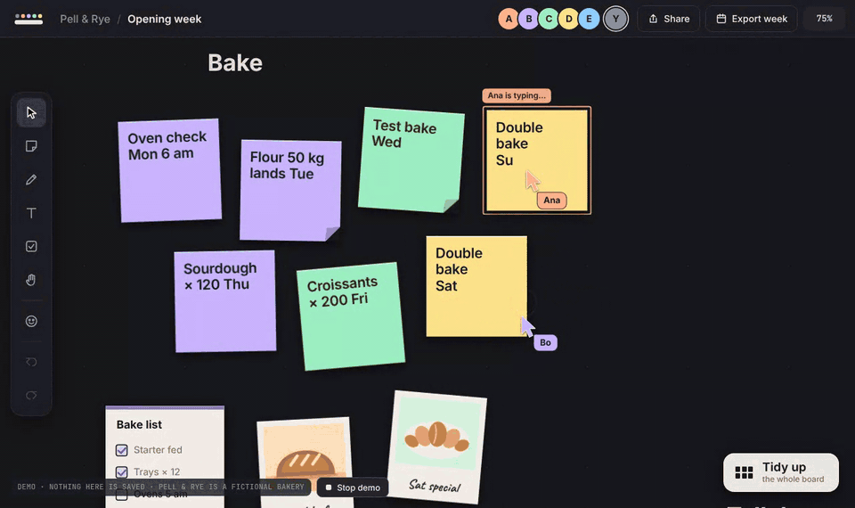
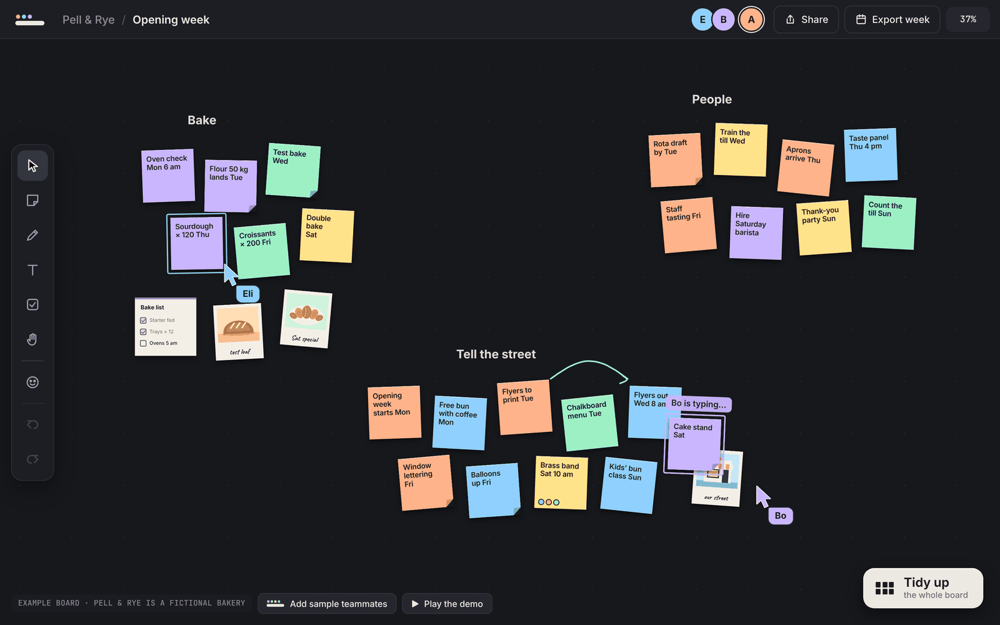
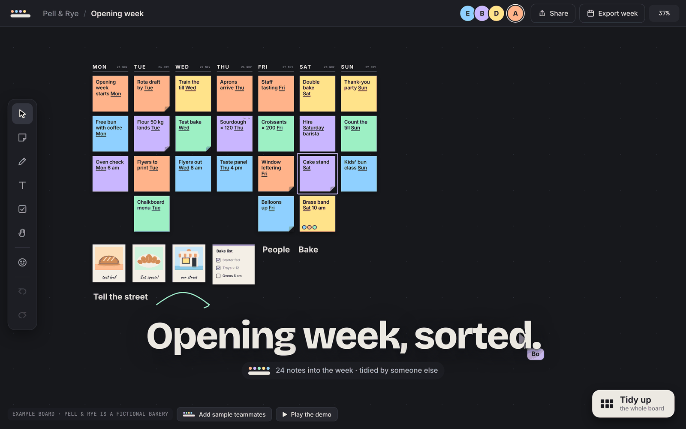
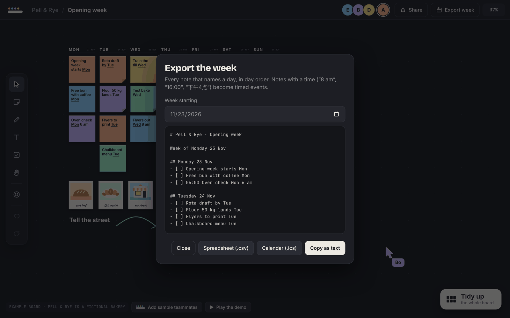
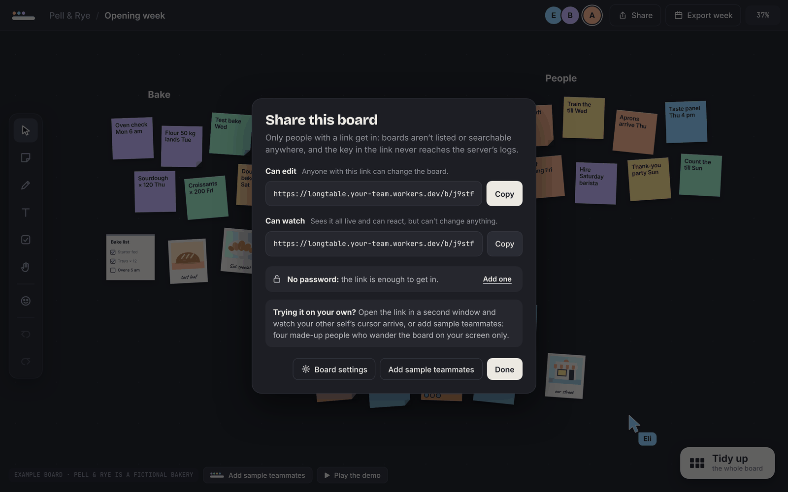
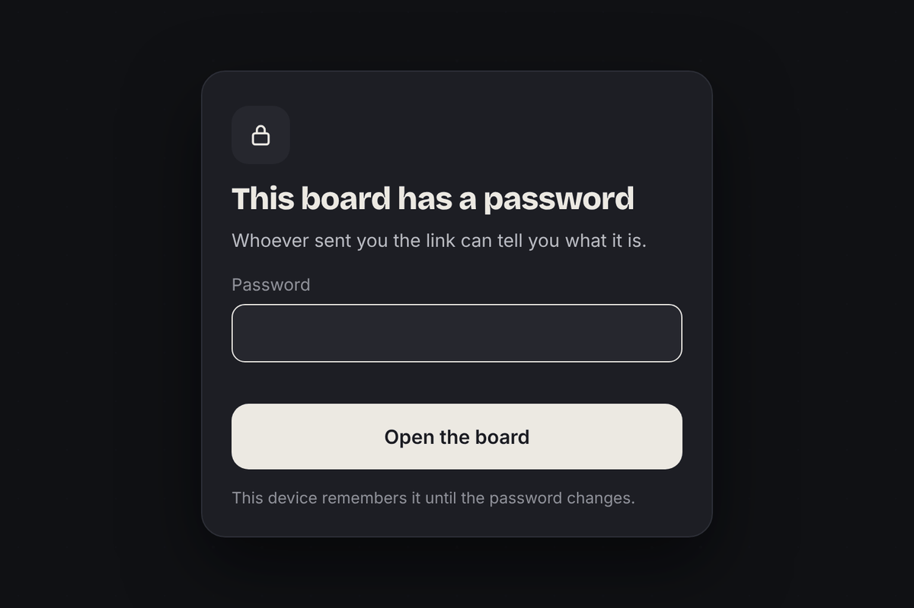
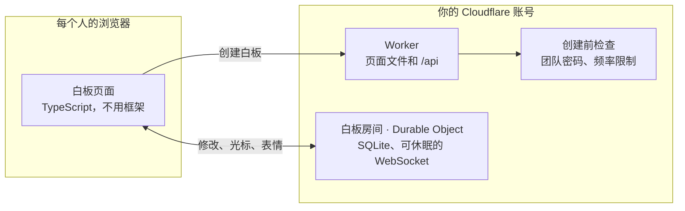

<div align="center">


# Longtable

**大家一起排计划，乱了也不怕，点一下就整理成一周。**

一块多人实时协作的计划白板：每个人同时写便签，看得到彼此的光标，连别人正在打的字也看得到。
点 **Tidy up**，每张便签自动归到它写的那一天；排好的一周可以复制成文字，也能导出表格或日历。

[English](README.md) · **简体中文**

[](https://deploy.workers.cloudflare.com/?url=https://github.com/s045pd/longtable)
&nbsp;
[](LICENSE)
[](DEPLOY.md#what-the-free-plan-covers)
[](#默认就是私密的)



<sub>首页会自己播放这一段：五个虚构的人给一家虚构的面包店排开业周，最后 Ana 按下 Tidy up。</sub>

</div>

---

## 目录

- [能做什么](#能做什么)
- [默认就是私密的](#默认就是私密的)
- [部署一个自己的](#部署一个自己的)
- [快捷键](#快捷键)
- [本地开发](#本地开发)
- [怎么做的](#怎么做的)
- [许可和致谢](#许可和致谢)

## 能做什么

<table>
<tr>
<td width="50%" valign="top">

### 拿到链接就能一起排

不用注册，一块白板就是一个链接。每个人的光标都带着名字，选中的东西显示成各自的颜色，
打字时别人那边一个字一个字地出现。点顶栏上某个人的头像，你的画面就跟着他走。

双击空白处写**便签**，也可以加**标题**、**清单**，或者用**画笔**。拖动来移动，
按住 `Alt` 拖动是复制，粘贴一段多行文字会变成一行一张便签。
可以用自己颜色的圆点投票，也可以发表情，表情会从你的光标处飘起来。

</td>
<td width="50%"></td>
</tr>
<tr>
<td width="50%"></td>
<td width="50%" valign="top">

### 一键整理成一周

便签上照平常的习惯写日子就行，比如「Flyers out Wed 8 am」「周四下午4点试吃」。
点 **Tidy up**，每张便签像波浪一样弹进它那天的那一列：没写时间的排前面，有时间的按先后排。
没写日子的进「Any day」那列；照片、清单和标题排在这一周下面。以后再整理一次，
新加的便签会插进已经排好的一周。撤销一次就能全部恢复。

想自己定也可以：按 **Day**（`D`）手动选哪天、几点，或者直接把便签拖进某一列。

</td>
</tr>
<tr>
<td width="50%" valign="top">

### 排好的一周发到哪都行

**Export week** 可以复制成 Markdown 发到群里，也可以下载 **CSV**（用表格打开）
或 **`.ics`** 日历文件，有时间的是定时日程，没时间的是全天日程。设好这周从哪天开始，
每张便签就对上了真实日期。

### 手机能用，断网一会儿也不丢

一根手指拖动，两根手指缩放，工具栏在屏幕下方。断网时做的修改会先存着，
连上之后自动发出去。

</td>
<td width="50%"></td>
</tr>
</table>

## 默认就是私密的

<table>
<tr>
<td width="50%"></td>
<td width="50%"></td>
</tr>
</table>

只知道白板地址是进不去的。白板链接在 `#` 后面带着一段密钥，浏览器从来不会把 `#`
后面的部分发给服务器，所以它也不会出现在任何日志里。**Share** 里有两个链接：
一个能**编辑**，一个只能**看**（实时看到全部内容，可以指、可以发表情，但什么都改不了）。

谁创建了白板，谁就是主人。在 **Share → Board settings** 里，主人可以：

- **设密码、改密码、去掉密码。** 其他人每台设备输入一次就行。改了密码之后，正在白板上的其他人也会立刻回到输入密码的页面。
- **换一套新链接。** 旧链接马上失效。
- **清空白板**（撤销能恢复），或者把它从服务器上**彻底删除**。

| | 怎么做的 |
| --- | --- |
| 链接密钥 | 26 位随机字符，约 130 位强度。主人密钥只存 SHA-256 哈希。 |
| 密码 | PBKDF2-SHA-256，10 万轮，每块白板单独加盐。同一个地址连续输错 5 次后要等 30 秒，之后每次翻倍，最多 15 分钟。错误次数存在白板自己的存储里，保留一天，存的是地址的哈希，不是地址本身。 |
| 只读链接 | 服务器会拒绝它发来的每一个修改，不只是页面上不让点。 |
| 创建白板 | 可以设一个**团队密码**。不设的话，同一个地址每小时也只能建 30 块白板。 |
| 页面 | 严格的内容安全策略（CSP），不带来源信息、不允许被嵌入，每个页面都要求搜索引擎不收录。 |
| 删除 | 白板的存储整个清掉，只留下删除日期，好让旧链接告诉别人它已经删了。 |

想让整个站点只有公司账号能登录，可以在前面加一层
[Cloudflare Access](https://developers.cloudflare.com/cloudflare-one/applications/configure-apps/self-hosted-public-app/)，50 人以内免费。

发现安全问题，请看 [SECURITY.md](SECURITY.md)。

## 部署一个自己的

Longtable 完全跑在 **Cloudflare 免费套餐**上：一个 Worker 提供页面和接口，每块白板是一个
[Durable Object](https://developers.cloudflare.com/durable-objects/)，自带一个 SQLite 数据库。
白板数据都在你自己的 Cloudflare 账号里，不经过任何其他服务。

**只要一个 API 令牌**（电脑上需要 Node.js 20 或更新版本）：

1. 打开这个链接创建令牌，它已经帮你填好了需要的两项权限：
   **[创建 Longtable 令牌](https://dash.cloudflare.com/profile/api-tokens?permissionGroupKeys=%5B%7B%22key%22%3A%22workers_scripts%22%2C%22type%22%3A%22edit%22%7D%2C%7B%22key%22%3A%22account_settings%22%2C%22type%22%3A%22read%22%7D%5D&accountId=*&zoneId=all&name=Longtable%20deploy)**
   页面上应该列着 **Account · Workers Scripts · Edit** 和 **Account · Account Settings · Read**。
   在 Account Resources 里选你的账号，点 *Continue to summary*，再点 *Create Token*，复制令牌。
   （如果链接没填好权限，选模板 **Edit Cloudflare Workers** 也行，只是权限多一些。）
2. 在这个项目的文件夹里运行：

   ```sh
   npm run setup
   ```

   按提示粘贴令牌（输入时不显示，也不会被保存）。它会自己找到你的账号，问你起个名字
   （默认 `longtable`），问要不要设团队密码，然后安装、构建、部署，最后检查一遍。
   结束时打印出你的地址：`https://longtable.<你的子域名>.workers.dev`。

以后要更新，拿到新代码再运行一次 `npm run setup` 就行，已有的白板都在。

不想回答问题、写进脚本里的话：

```sh
CLOUDFLARE_API_TOKEN=… npm run setup -- --yes --name longtable --team-password '…'
```

**其他方式：** 上面的 **Deploy to Cloudflare** 按钮（它会把仓库复制到你的 GitHub 账号再部署，
所以要求这个仓库是公开的）；在你自己的仓库里用 GitHub Actions 部署；或者手动
`npx wrangler login` 再 `npm run deploy`。每种方式的细节，以及绑定自己的域名、免费套餐够用多少、
数据存在哪，都在 [DEPLOY.md](DEPLOY.md)（英文）里。

## 快捷键

| 按键 | 作用 | 按键 | 作用 |
| --- | --- | --- | --- |
| `V` | 选择 | `U` | 整理（Tidy up） |
| `N` | 便签 | `D` | 给选中的便签选日子 |
| `T` | 标题 | `Enter` | 编辑选中的便签 |
| `C` | 清单 | `Delete` | 删除 |
| `P` | 画笔 | 方向键 | 微调位置（按住 `Shift` 移得更多） |
| `H` 或按住 `Space` | 拖动画布 | `⌘D` | 复制一份 |
| `+` `−` | 缩放 | `⌘A` | 全选 |
| `⇧1` / `⇧0` | 显示全部 / 100% | `⌘Z` / `⇧⌘Z` | 撤销 / 重做 |

`Esc` 会停下演示，把那块白板交给你。Windows 和 Linux 上用 `Ctrl` 代替 `⌘`。

## 本地开发

```sh
npm install
npm run dev:worker     # 先构建，再在 http://localhost:8787 跑起页面和实时白板
npm run dev            # 只跑前端，改代码自动刷新；白板只存在这个浏览器里
```

```sh
npm test               # 单元测试：识别日子和时间、整理、校验、导出、权限
npm run typecheck      # 前端和 Worker 的类型检查
npm run build && npm run e2e
```

端到端测试会自己启动一个本地 Worker，用 Playwright 同时开几个浏览器和一部手机
（第一次需要 `npx playwright install chromium`）。它覆盖多人实时编辑、整理、导出，
以及所有隐私规则：没有密钥和瞎编密钥的链接、只读链接（也包括直接连服务器的脚本）、
密码和输错之后的等待、同时发出的一堆猜测、换链接、清空、删除、团队密码、建白板的频率限制和安全响应头。
要测已经部署好的站点：`BASE_URL=https://… npm run e2e`（设了团队密码就再加 `TEAM_PASSWORD=…`）。

## 怎么做的



每一次修改都是一个 **op**：`put`、`patch`、`del`、`vote` 或 `meta`。浏览器先在本地应用自己的 op，
记下反向操作用来撤销，再发出去。白板房间按 schema 检查每个 op，按到达顺序应用，转发给其他人，
并且最多每秒写一次存储，所以拖动一张便签只写一次，而不是几百次。文字、位置、颜色按字段以最后一次写入为准；
投票是每人各一份，两个人同时投也不会冲突。光标、选中状态和谁在线只转发、从不存储。
空闲的标签页保持连接也不会唤醒房间，所以开着但没人动的白板不花钱。

```
src/shared/   前后端共用的模型：便签和 op、每个修改都要过的校验、应用和撤销、
              识别日子和时间、整理、导出、模板
src/board/    浏览器里的白板：状态和撤销（app.ts）、各类元素（views.ts）、鼠标触摸和键盘
              （input.ts）、打字（editor.ts）、光标（people.ts）、工具栏和对话框（chrome.ts）、
              连接（net.ts）、首页演示（demo.ts）
worker/       接口和静态文件（index.ts）、一块白板的房间（room.ts）、
              密钥、密码和输错计数（access.ts）
scripts/      npm run setup（deploy-cloudflare.mjs）
e2e/          端到端测试
```

外观来自 Longtable 最初的那支短片：深色画布上的点阵网格，缩小时会变稀；便签是五种雪糕色配深色字；
界面用 Inter，结尾那行大字用 Bricolage Grotesque，手写说明用 Caveat。

## 许可和致谢

Copyright © 2026 s045pd。Longtable 是自由软件，使用 [GNU Affero 通用公共许可证 v3.0](LICENSE)：
可以随便用、随便改，给自己的团队部署也没有限制。如果把改过的版本通过网络提供给别人用，也要把你改动的源代码提供给他们。

字体都从 [Fontsource](https://fontsource.org) 打包进来，使用 SIL Open Font License：
Inter、Bricolage Grotesque、Caveat 和 JetBrains Mono。Pell & Rye 这家店、白板上的人和他们计划的事全是虚构的。
